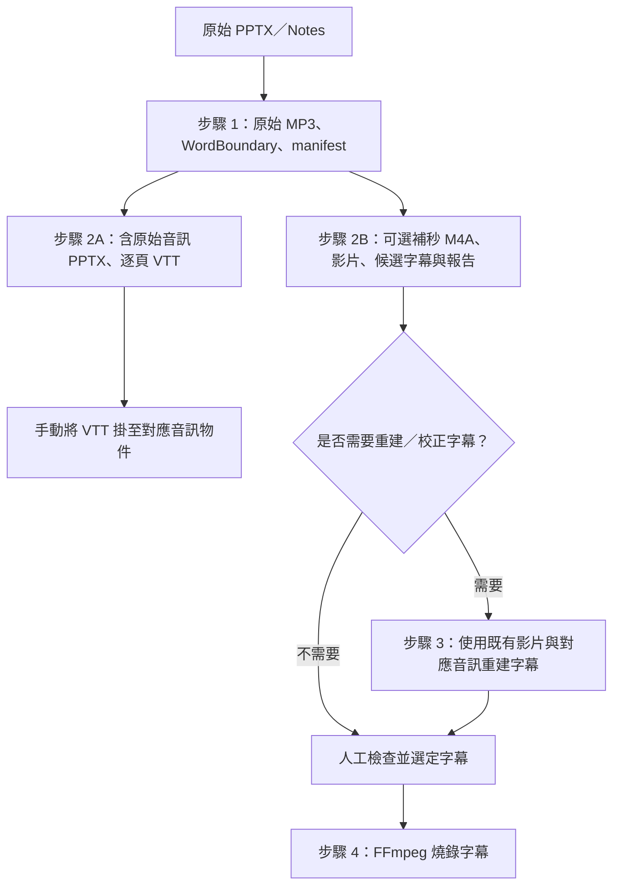

# 從原始 PPTX 到音訊簡報與字幕影片

本手冊整理兩種產出共用的原始音訊，以及後續相依步驟。TTS 介面與限制見
[TTS 後端](TTS_BACKENDS.md)，補秒與候選字幕細節見 [音訊準備](AUDIO_PREPARATION.md)。

## 流程與相依性



- 步驟 2A、2B 皆依賴步驟 1，彼此不相依；後續不用指定 TTS 後端。
- 2A 使用未補秒的原始 MP3，VTT 相對於每頁音訊起點；不自動掛載 VTT。
- 2B 可使用補秒 M4A，匯出後生成候選字幕並保留退回／定位警告；不能統稱所有頁面皆精準實測。
- 步驟 3 可省略。只更新字幕時，不需重做 TTS、音訊插入或 PowerPoint 匯出。
- 步驟 4 依賴已選定的字幕與對應影片，不自動決定哪份候選字幕正確。
- PowerPoint 的既有 `PlayOnEntry` 設定維持不變；使用者依需要手動調整播放屬性。
- 長影片切割仍依使用者決定暫緩，不納入本輪完成範圍；既有工具說明保留於 [分段手冊](SPLIT_VIDEO.md)。

## 執行環境與共同路徑

在專案根目錄執行，先確認使用本工作目錄的 `.venv`：

```powershell
Set-Location "D:\WorkingCopy\pptx"
.\.venv\Scripts\Activate.ps1
python -c "import sys; print(sys.executable); print(sys.version)"

$Examples = "examples"
$Output   = "output\MPU_WK04"

New-Item -ItemType Directory -Force `
  -Path "$Output\pptx", "$Output\video" | Out-Null
```

Python 路徑應指向 `D:\WorkingCopy\pptx\.venv\Scripts\python.exe`。若改用其他工作目錄，
請對應調整路徑。後續假設原始簡報為 `$Examples\MPU_WK04.pptx`。
音訊插入／影片匯出需要 PowerPoint 及 pywin32，音訊準備、字幕量測／燒錄需要 FFmpeg／ffprobe。

## 步驟 1：生成共用原始音訊

以下明確使用實驗性 `edge-websocket`；改成 `edge-tts` 即選用原套件，省略後端參數也預設為原套件。
不自動切換後端。

```powershell
python -m pptx2video "$Examples\MPU_WK04.pptx" `
  --generate-audio `
  --tts-backend edge-websocket `
  --audio-output-dir "$Output\audio" `
  --output "$Output\slides_source.json" `
  --subtitles-output= `
  --rate=+0% `
  --pitch=+0Hz `
  --tts-max-retries 10 `
  --tts-retry-delay 5 `
  --verbose
```

`10` 是額外重試次數，每頁最多嘗試 11 次；`5` 是失敗後的等待秒數，不是成功頁面之間的固定間隔。
兩後端皆接受正常語速及零音高；新後端的非零音高須以百分比表示，例如 `--pitch=+5%`。

產物為 `audio\slide_NNN.mp3`、`audio\slide_NNN.wordboundaries.json`、`audio\manifest.json`，
以及 `slides_source.json`。只有具有 Notes 的頁面生成旁白。已有完整資料時可跳過此步。

只重生指定頁面可在同一命令加 `--slides 7`，舊 manifest 其餘頁面及後端來源保留。
原文、聲音或語速改變而重生音訊後，須重新產生相關 VTT、prepared 音訊、含音訊 PPTX、影片及字幕；
衍生成品不會自動更新。請持續使用乾淨原始 PPTX 作為插入來源，以免重複加入音訊物件。

整批合成完成後才發布成品；合成失敗保留舊資料。本輪失敗時，目錄裡的舊 `ready` 不代表
最新稿件已生成成功，必須同時查看執行結果。若發布中斷留下 `incomplete`，先不帶 `--slides`、
不帶補秒參數，完整重跑本步，再執行衍生流程。

## 步驟 2A：含音訊 PPTX 與逐頁 VTT

```powershell
python -m pptx2video "$Examples\MPU_WK04.pptx" `
  --audio-output-dir "$Output\audio" `
  --vtt-output-dir "$Output\pptx\vtt" `
  --insert-audio `
  --pptx-output "$Output\pptx\deck_with_audio.pptx" `
  --output "$Output\pptx\slides.json" `
  --subtitles-output= `
  --verbose
```

完成後在 PowerPoint 手動將 `slide_NNN.vtt` 掛載到對應頁音訊物件。音訊不補尾秒。
字幕驗證失敗會在音訊插入前中止；此前寫出的 slides.json 或目錄中舊 PPTX 不代表本次完整成功。
詳見 [每頁 VTT](PER_SLIDE_VTT.md)。

## 步驟 2B：補 4 秒音訊、產生影片與候選字幕

```powershell
python -m pptx2video "$Examples\MPU_WK04.pptx" `
  --audio-output-dir "$Output\audio" `
  --audio-tail-silence 4 `
  --prepared-audio-dir "$Output\video\audio_prepared" `
  --insert-audio `
  --pptx-output "$Output\video\deck_with_audio.pptx" `
  --export-video `
  --video-output "$Output\video\deck.mp4" `
  --video-resolution 1080 `
  --video-timeout 7200 `
  --subtitles-output "$Output\video\captions.srt" `
  --global-scale-correction 1.0 `
  --output "$Output\video\slides.json" `
  --verbose
```

720p 改為 `--video-resolution 720`。不補秒時，移除 `--audio-tail-silence` 與
`--prepared-audio-dir` 兩行。解析度參數是高度；實際寬度依投影片比例而定。

主要產物為 `deck_with_audio.pptx`、`deck.mp4`、`slides.json`，以及
`captions_preview.srt`、`captions_initial.srt`、`captions.srt`、`captions_alignment_report.json`。
preview 為匯出前預測；匯出後再定位生成 initial／captions。係數為 1.0 時後兩份可能相同，
不表示定位沒有退回頁。先看警告及報告，檢查字幕與聲音，再決定要不要重建。

## 步驟 3：必要時重建校正字幕

```powershell
python scripts/regenerate_srt_from_export.py `
  --video "$Output\video\deck.mp4" `
  --manifest "$Output\video\audio_prepared\manifest.json" `
  --slides-json "$Output\video\slides.json" `
  --output "$Output\video\captions.srt" `
  --global-scale-correction 1.0
```

將 `1.0` 換成本片驗證的係數，不能沿用其他影片的經驗值當通用設定。
若影片使用未補秒 MP3，將 manifest 那行改成：

```powershell
  --manifest "$Output\audio\manifest.json" `
```

manifest 必須對應實際嵌入並匯出的音訊。重建會更新候選字幕與報告；已有手動編輯的版本請先另存。

## 步驟 4：燒錄確認後的字幕

```powershell
python scripts/burn_subtitles.py `
  --video "$Output\video\deck.mp4" `
  --srt "$Output\video\captions.srt" `
  --output "$Output\video\deck_burned.mp4"
```

若人工選用 initial，SRT 檔名改為 `captions_initial.srt`。
1280×720／1920×1080 預設自動縮放黑條。1440×1080 等其他尺寸須提供全部三個黑條參數，
例如以下數值仍需目視核對字型與字幕行寬：

```powershell
python scripts/burn_subtitles.py `
  --video "$Output\video\deck.mp4" `
  --srt "$Output\video\captions.srt" `
  --output "$Output\video\deck_burned.mp4" `
  --bar-width 975 `
  --bar-height 57 `
  --bar-bottom-offset 60
```

## 驗證紀錄與尚未解決事項（2026-11-19）

以下區分使用者回報、實際 log 與自動化測試，不代表所有教材／環境皆已驗收：

| 範圍 | 已知證據 |
| --- | --- |
| 完整操作流程 | 使用者回報已以實際教材執行步驟 1 → 2A／2B → 必要時 3 → 4；未另提供影片階段完整 log、採用的係數及逐頁品質結論 |
| MPU_WK04 步驟 1 | 已提供 27 頁成功 log，全部 edge-websocket，manifest ready；第 16、26 頁各兩次 429 後成功。當次使用 Python 3.9 全域環境，後續已重新啟用 .venv |
| MPU_WK04 步驟 2A | 修正 XML metadata 後，使用者 log 確認 27 份 VTT、27 頁音訊插入、0 跳過並完成儲存；PowerPoint 視窗仍保留 |
| 字幕相容性 | 開發端以現有 27 組資料生成 VTT 及預測 SRT 無警告，雜湊確認 MP3、sidecar、manifest 不變；不是完整影片對齊精度的證明 |
| 自動化回歸 | XML 修正後曾完整執行 281 項測試通過；屬歷史紀錄，本次文件更新未重新執行測試 |

尚未解決：新後端真實 TLS transport 在 Python 3.9 出現 `Event loop is closed` 清理例外；
429 目前仍固定間隔重試；PowerPoint Close／Quit 例外仍被忽略，成功訊息不保證視窗已關閉。
這三項列入 [TODO](../TODO.md)，尚未因完整流程已執行而視為修復。
VTT 手動掛載與播放、整片字幕同步及音畫品質，仍須依實際成品驗收，不由檔案存在推定。
